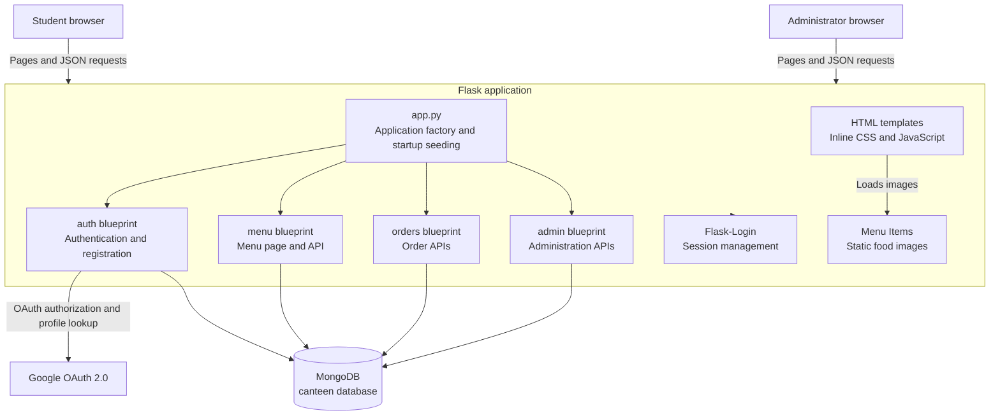
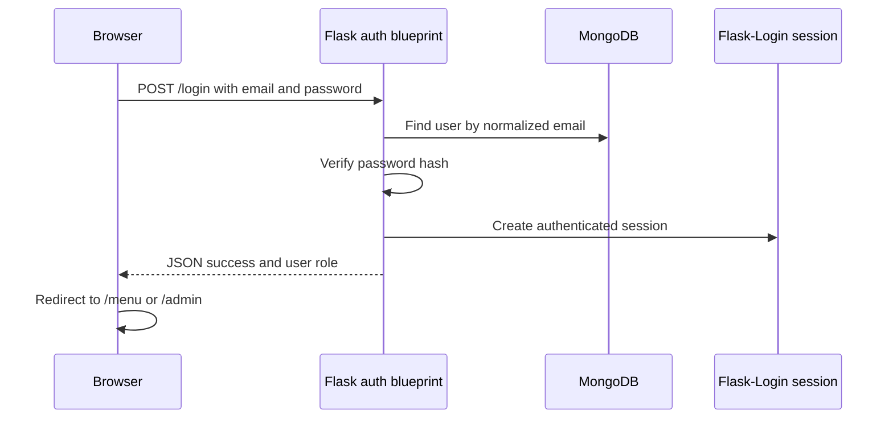
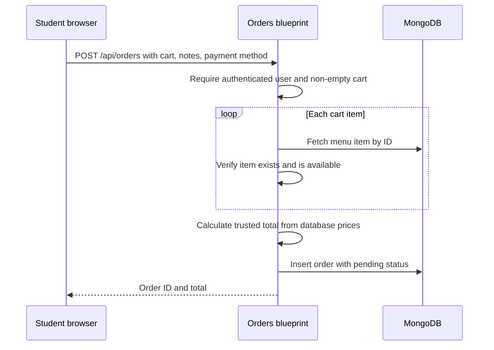
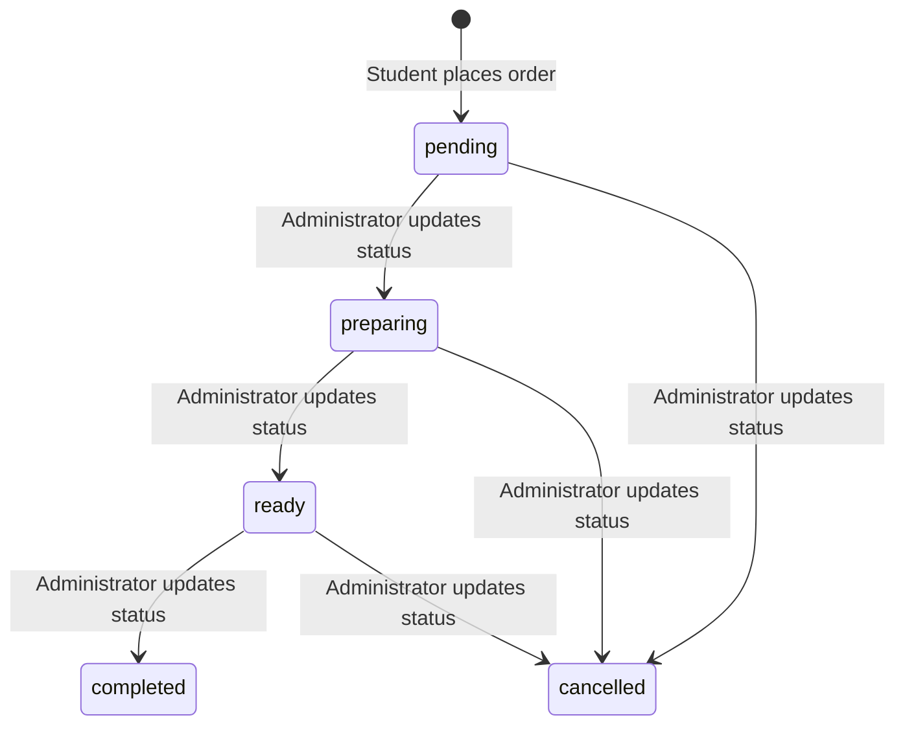
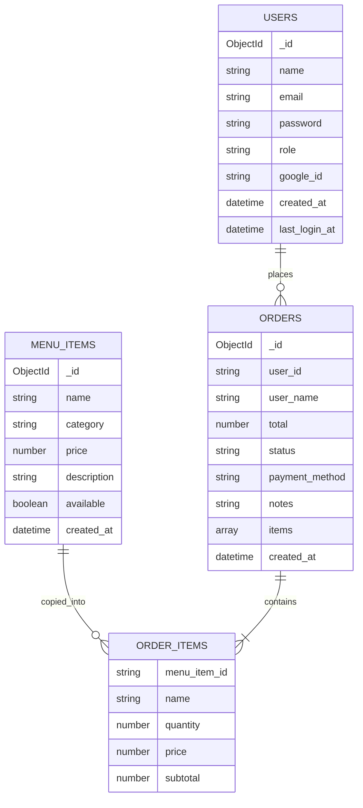

# Project Architecture

## Overview

Campus Canteen is a server-rendered web application for online food ordering. It uses a Flask application as both the page server and JSON API, MongoDB as the persistent data store, and browser-side JavaScript for interactive carts, orders, and administration features.

## Application Layers

| Layer | Responsibilities | Main files |
| --- | --- | --- |
| Application bootstrap | Builds the Flask app, reads configuration, initializes extensions, registers routes, serves menu images, and seeds an empty database. | `backend/app.py` |
| Authentication and authorization | Handles email/password registration and login, optional Google OAuth, logout, sessions, user loading, and administrator role checks. | `backend/routes/auth.py`, `backend/models.py`, `backend/extensions.py`, `backend/routes/admin.py` |
| Student ordering | Serves the menu and orders pages, exposes menu data, creates orders, and returns a user's orders. | `backend/routes/menu.py`, `backend/routes/orders.py` |
| Administration | Serves the administrator dashboard and exposes order, menu-management, and statistics APIs. | `backend/routes/admin.py` |
| Presentation | Defines the static Vercel pages and legacy Flask templates. JavaScript in the static frontend calls the Flask JSON APIs. | `frontend/`, `backend/templates/` |
| Persistence | Provides a shared PyMongo client and stores users, menu items, and orders as MongoDB documents. | `extensions.py`, MongoDB |
| Shared utilities | Converts string IDs to a MongoDB `_id` query filter without throwing for invalid identifiers. | `mongo_helpers.py` |

## Startup Sequence

1. `backend/app.py` loads variables from `backend/.env` during local development.
2. `create_app()` creates the Flask application and reads `SECRET_KEY` and `MONGO_URI`.
3. The PyMongo and Flask-Login extensions are initialized.
4. Flask blueprints for authentication, menu, orders, and administration are registered.
5. The `/menu-items/<filename>` route is registered to serve images from `Menu Items/`.
6. `seed_data()` runs in local development or when `SEED_DEMO_DATA=true`. It adds menu items when needed and only creates seed users from explicit `SEED_*` environment variables.
7. Running `python app.py` from `backend/` starts the development server on port `5000`.

## Request Flow

### Email and password authentication

New users are created through `POST /register`. Passwords are stored using Werkzeug password hashing, and registered users receive the `student` role.

### Google sign-in

1. The browser requests `/login/google`.
2. The application checks for `GOOGLE_CLIENT_ID` and `GOOGLE_CLIENT_SECRET`; if either is absent, it redirects to the login page with an error.
3. A random OAuth state value is stored in the Flask session, and the browser is redirected to Google.
4. Google returns to `/login/google/callback` with an authorization code and state.
5. The application validates the state, exchanges the code for an access token, and retrieves the Google profile.
6. The user is found or created in MongoDB, then authenticated with Flask-Login and redirected to `/menu`.

### Order creation

The server calculates each subtotal and the overall total from the menu item stored in MongoDB; it does not accept client-provided prices.

### Order status lifecycle

The API accepts the statuses `pending`, `preparing`, `ready`, `completed`, and `cancelled`. The interface refreshes student orders every 15 seconds and active administrator dashboard data every 20 seconds, so updates are polling-based rather than pushed in real time.

## Data Architecture

MongoDB is accessed through PyMongo. The default database name is `canteen` when the local fallback URI is used.

### Collections

| Collection | Purpose | Important fields |
| --- | --- | --- |
| `users` | Account and role records. | `_id`, `name`, `email`, `password`, `role`, optional Google fields |
| `menu_items` | Canteen menu catalog. | `_id`, `name`, `category`, `price`, `description`, `available` |
| `orders` | Submitted orders and their progress. | `_id`, `user_id`, `user_name`, `items`, `total`, `status`, `payment_method`, `notes`, `created_at` |

Order items are embedded snapshots in each order. Each embedded item contains the menu item ID, name, quantity, unit price, and subtotal. This preserves the order record when a menu item is later changed or deleted.

## Routes and API Boundaries

### Pages

| Route | Access | Response | Purpose |
| --- | --- | --- | --- |
| `/` | Public | Redirect | Sends an authenticated user to their appropriate home page or otherwise to login. |
| `/login` | Public | HTML / JSON | Shows sign-in form; accepts email/password sign-in. |
| `/register` | Public | HTML / JSON | Shows registration form; creates student accounts. |
| `/login/google` | Public | Redirect | Starts Google OAuth when configured. |
| `/menu` | Authenticated | HTML | Student menu and cart page. |
| `/orders` | Authenticated | HTML | Current user's order history page. |
| `/admin` | Administrator | HTML | Administration dashboard. |
| `/logout` | Authenticated | Redirect | Ends the active session. |

### JSON APIs

| Route | Method | Access | Purpose |
| --- | --- | --- | --- |
| `/api/menu` | GET | Authenticated | Returns menu items grouped by category. |
| `/api/orders` | POST | Authenticated | Validates cart and creates a pending order. |
| `/api/orders/my` | GET | Authenticated | Returns the current user's orders. |
| `/api/orders/<order_id>` | GET | Owner or administrator | Returns a single order. |
| `/api/admin/orders` | GET | Administrator | Returns up to 100 orders; supports a `status` filter. |
| `/api/admin/orders/<order_id>/status` | PUT | Administrator | Changes an order status. |
| `/api/admin/menu` | POST | Administrator | Creates a menu item. |
| `/api/admin/menu/<item_id>` | PUT | Administrator | Updates a menu item. |
| `/api/admin/menu/<item_id>` | DELETE | Administrator | Deletes a menu item. |
| `/api/admin/stats` | GET | Administrator | Returns dashboard counts and completed-order revenue. |

## Security Model

- `SECRET_KEY` signs the Flask session and should be configured with a unique production value.
- Flask-Login protects user routes with `@login_required`.
- The `admin_required` decorator checks the authenticated user's `role` before administrative actions are allowed.
- Passwords are hashed with Werkzeug before storage and verified through `check_password_hash`.
- Google OAuth uses an application-generated state value held in the session to validate the callback.
- `id_filter()` handles MongoDB `ObjectId` conversion and prevents invalid IDs from causing conversion errors.
- MongoDB credentials, OAuth credentials, and the Flask secret are environment configuration and should not be committed to source control.

## Frontend Architecture

Each page is an independent server-rendered HTML template with embedded styles and JavaScript. There is no separate frontend build process or client-side framework.

| Template | Browser responsibilities | Backend APIs used |
| --- | --- | --- |
| `login.html` | Switches login/register panels, sends authentication requests, and shows authentication errors. | `/login`, `/register`, `/login/google` |
| `menu.html` | Loads menu categories, maintains the cart in browser memory, and submits orders. | `/api/menu`, `/api/orders` |
| `orders.html` | Loads and periodically refreshes the current user's orders. | `/api/orders/my` |
| `admin.html` | Displays statistics, orders, and menu management controls; periodically refreshes active dashboard data. | `/api/admin/*`, `/api/menu` |

The `backend/Menu Items/` directory holds backend-served image assets. The static frontend deploys its own copy in `frontend/menu-items/`.

## Configuration and Deployment Considerations

| Setting | Purpose | Development fallback |
| --- | --- | --- |
| `SECRET_KEY` | Protects Flask session data. | `dev-only-canteen-secret-key` outside production only |
| `MONGO_URI` | MongoDB connection string. | `mongodb://localhost:27017/canteen` |
| `GOOGLE_CLIENT_ID` | Google OAuth client identifier. | Google sign-in is disabled. |
| `GOOGLE_CLIENT_SECRET` | Google OAuth client secret. | Google sign-in is disabled. |

Before production deployment, provide all secrets through the deployment environment, use a production WSGI server instead of Flask's development server, and ensure MongoDB is secured and backed up.
